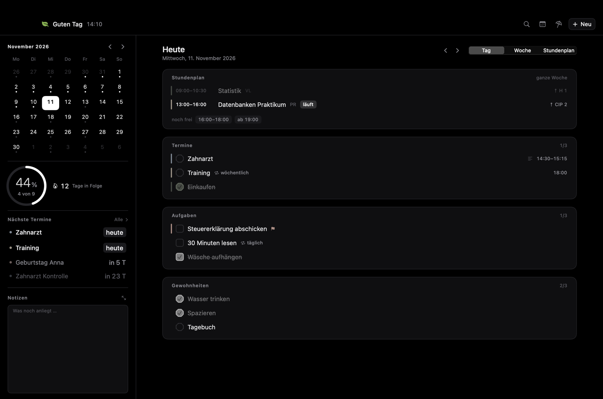
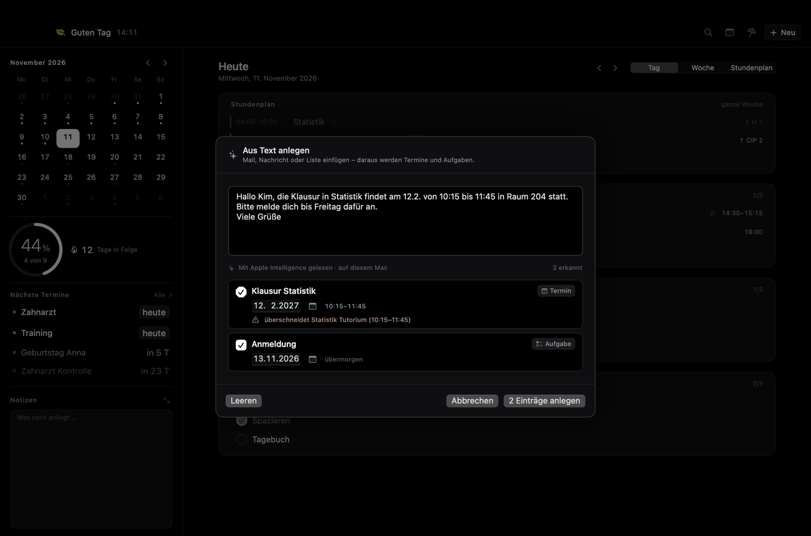
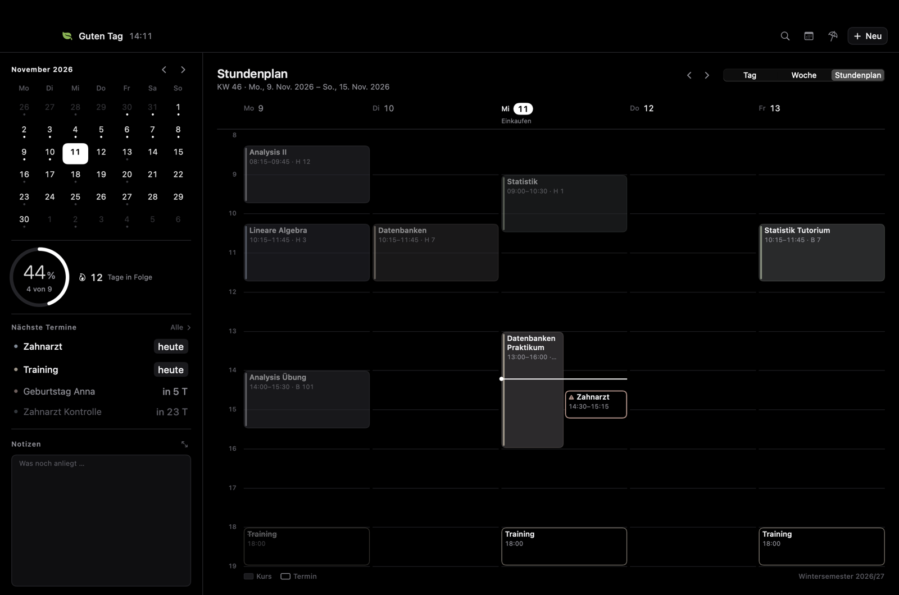
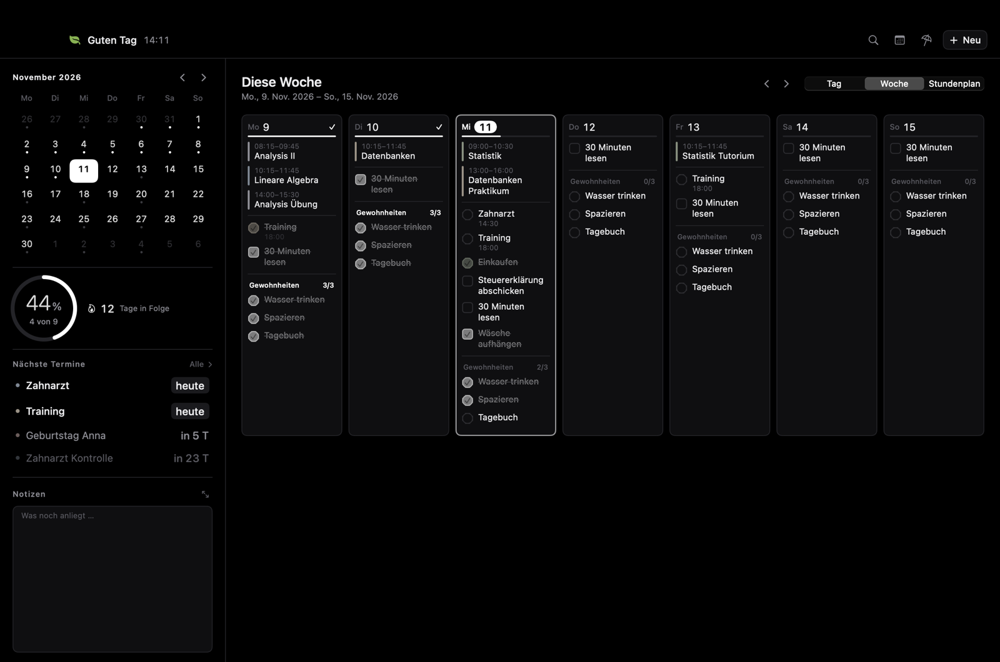

# Planer

**Ein ruhiger Tagesplaner für den Mac – mit einer KI, die Termine aus Text liest und dabei nichts erfindet.**

Termine, Aufgaben, Gewohnheiten und Stundenplan in einem Fenster. Eine Mail einfügen, und der Planer macht Termine daraus – mit dem Sprachmodell, das auf dem Mac selbst läuft. Kein Konto, keine Cloud, keine Netzwerkverbindung.

*A calm day planner for macOS with on-device AI that turns pasted text into appointments and tasks – without inventing anything. Fully local: no account, no cloud, no network access. The interface is in German.*



## Auf einen Blick

- **KI auf dem Gerät** – Text einfügen, Termine und Aufgaben kommen heraus. Apples Sprachmodell läuft lokal; kein Text verlässt den Rechner, es entstehen keine Kosten.
- **Verlässlich statt geraten** – Datum, Uhrzeit und Dauer bestimmen feste Regeln, nicht das Modell. Was die KI vorschlägt, wird gegen den Text geprüft.
- **Stundenplan mit freier Zeit** – Kurse und Termine in einer Ansicht; beim Planen ist sofort zu sehen, wann Zeit ist und wo es sich überschneidet.
- **Datenschutz als Grundsatz** – alles bleibt in einer Datei auf dem eigenen Mac, nur für den eigenen Benutzer lesbar.

## Aus Text anlegen



Eine Nachricht wie im Bild – „die Klausur in Statistik findet am 12.2. von 10:15 bis 11:45 statt, bitte melde dich bis Freitag dafür an" – wird zu zwei Einträgen:

- **Klausur Statistik**, ein Termin am 12. Februar von 10:15 bis 11:45. Das Jahr fehlt im Text; der Planer nimmt das nächste Vorkommen, also das kommende Jahr.
- **Anmeldung**, eine Aufgabe mit Frist Freitag – erkannt an „bis Freitag".
- Dazu die Warnung, dass sich die Klausur mit einem Kurs aus dem Stundenplan überschneidet.

Angelegt wird erst, wenn man bestätigt. Jeder Entwurf lässt sich vorher ändern, umschalten oder abwählen.

### Wie es funktioniert

Kleine Sprachmodelle verstehen Text gut, rechnen aber unzuverlässig: Sie verrutschen beim Wochentag, vergessen den Jahreswechsel oder schätzen eine Dauer. Der Planer teilt die Arbeit deshalb so auf, dass jede Seite nur tut, was sie verlässlich kann:

1. **Regeln lesen sofort.** Ein eigener Textleser erkennt deutsche Datums- und Zeitangaben – „12.2.", „nächsten Dienstag", „morgen um 9", „14–16 Uhr", „bis Freitag" – und berechnet daraus Tag, Uhrzeit, Dauer und Fristen. Die Entwürfe erscheinen ohne Wartezeit.
2. **Das Sprachmodell benennt.** Steht Apple Intelligence bereit (ab macOS 26), liest Apples Modell den Text auf dem Gerät mit. Es findet passende Titel, trennt mehrere Einträge sauber voneinander und lässt Grüße und Floskeln weg.
3. **Jeder Vorschlag wird geprüft.** Ein Titel, der sich nicht im eingefügten Text wiederfindet, wird verworfen. Das Modell kann kein Datum setzen und keines verschieben – es antwortet nur in einem festen Format, das als Daten gelesen und nie ausgeführt wird.
4. **Abgleich mit dem Kalender.** Jeder Entwurf wird mit Stundenplan und bestehenden Terminen verglichen; Überschneidungen werden angezeigt, bevor etwas angelegt ist.

Ohne Apple Intelligence arbeiten die Regeln allein weiter – die Funktion bleibt nutzbar, nur die Titel sind schlichter. Allein der Textleser ist durch 50 Tests abgesichert.

## Was er kann

- **Tag, Woche, Stundenplan** – drei Ansichten auf dieselben Einträge.
- **Termine, Aufgaben, Gewohnheiten** – mit Wiederholungen, Abhaken, Fortschrittsring und Serie.
- **Stundenplan** – Kurse mit Anfang und Ende, wöchentlich oder in geraden/ungeraden Kalenderwochen, begrenzt auf das Semester. Kurse werden nicht abgehakt und zählen in keine Kennzahl: Ein Vorlesungstag ist kein halb erledigter Tag.
- **Freie Zeit sehen** – beim Anlegen eines Termins zeigt ein Belegungsstreifen, was schon steht, schlägt freie Zeiten vor und warnt bei Überschneidungen.
- **Alle Termine im Überblick** – nach Heute, Morgen, Woche und Monat gruppiert, direkt bearbeitbar.
- **Menüleiste** – Tagesfortschritt und die nächsten Einträge, ohne das Fenster zu öffnen.
- **Notizen** – ein Zettel neben dem Kalender, an keinen Tag gebunden.
- **Feiertage** – gesetzliche Feiertage in Bayern.

| Stundenplan | Woche |
|---|---|
|  |  |

## Über das Projekt

Der Planer ist aus eigenem Bedarf entstanden. Ich wollte Termine, Aufgaben, Gewohnheiten und Stundenplan an einem Ort haben – ruhig gestaltet, ohne Konto und Abo und ohne dass meine Daten den Rechner verlassen.

Idee, Anforderungen, Gestaltung und Produktentscheidungen stammen von mir. Den Code habe ich mit [Claude Code](https://claude.com/claude-code) umgesetzt, einem KI-Werkzeug für die Softwareentwicklung. Meine Rolle war die eines Produktverantwortlichen: festlegen, was die App können soll und was bewusst nicht; jede Fassung im Alltag benutzen; Schwächen finden und zurückmelden; und darauf achten, dass Datenschutz und Datensicherheit nie hinter neuen Funktionen zurückstehen.

**Entscheidungen, die den Planer ausmachen:**

- **Lokal statt Cloud.** Keine Netzwerkverbindung, keine laufenden Kosten, keine Abhängigkeit von einem Dienst. Ein Prüfskript stellt bei jedem Commit sicher, dass das so bleibt.
- **KI dort, wo sie stark ist.** Das Sprachmodell versteht Sprache, die Regeln rechnen. So bekommt man den Komfort einer KI ohne ihre typischen Fehler.
- **Kein Datenverlust.** Atomares Speichern, tägliche Sicherungen; eine beschädigte Datei wird beiseitegelegt statt überschrieben. Bei jeder Erweiterung wurde der bestehende Datenstand unverändert übernommen.
- **Der Stundenplan stört die Planung nicht.** Kurse zeigen, wann man keine Zeit hat, zählen aber in keine Statistik.
- **Persönliches bleibt draußen.** Vor jedem Commit und Push prüft ein Skript, dass weder Pfade, Mail-Adressen noch echte Einträge im Repository landen.

## Datenschutz

Der Planer ist so gebaut, dass es nichts gibt, was abfließen könnte.

- **Kein Netzwerk.** Im Quelltext steht kein einziger Netzwerkzugriff; `Scripts/privacy_check.sh` prüft das vor jedem Commit.
- **Eine Datei, lokal.** Alles liegt in `~/Library/Application Support/Planer/dashboard.json` – lesbares JSON, das einem selbst gehört. Ordner und Dateien sind nur für den eigenen Benutzer lesbar (Rechte `700`/`600`).
- **Sicherungen.** Beim Start entsteht höchstens eine Tagessicherung, 14 Stände werden aufbewahrt.
- **KI ohne Dritte.** Die Texterkennung nutzt ausschließlich das Modell auf dem Mac. Es gibt keinen Schlüssel, kein Konto und keine Übertragung.
- **Keine Telemetrie, keine Absturzberichte, keine Aktualisierungsprüfung.**

Mehr dazu in [SECURITY.md](SECURITY.md).

## Technik

- **Swift 6 und SwiftUI**, als reines Swift-Paket ohne Xcode-Projekt; gebaut wird mit den Command Line Tools.
- **Apple Foundation Models** für das Sprachmodell auf dem Gerät, mit Rückfall auf die Regeln, wenn es nicht verfügbar ist.
- **Keine fremden Bibliotheken.** Nur Apples eigene Frameworks.
- **255 automatische Tests** (Swift Testing) für Logik, Speichern, Sicherungen und Texterkennung.
- **Rund 11 800 Zeilen Swift**, aufgeteilt in drei Schichten:

```
Sources/
  PlanerCore/     Reine Logik ohne Oberfläche: Modell, Wiederholungen, Statistik,
                  Stundenplan, Textleser.
  PlanerData/     Speichern, Sicherungen, Zwischenspeicher.
  Planer/         Die App (SwiftUI), inklusive Anbindung an das Sprachmodell.
  PlanerWidget/   Widget für den Schreibtisch (siehe „Bekannte Grenzen").
Tests/            Tests für PlanerCore und PlanerData.
Scripts/          Bauen, Installieren, Testen, Datenschutz-Prüfung.
```

## Bauen und installieren

Voraussetzungen: macOS 14 oder neuer und die Command Line Tools (`xcode-select --install`). Xcode wird nicht gebraucht. Für die KI-Funktion: macOS 26 mit eingeschaltetem Apple Intelligence.

```bash
./Scripts/install.sh
```

Das baut die App, signiert sie lokal und legt sie nach `/Applications/Planer.app`. Liegt dort schon eine andere App gleichen Namens, bricht das Skript ab, statt sie zu ersetzen.

Nur bauen, ohne zu installieren:

```bash
./Scripts/build_app.sh
```

Tests:

```bash
./Scripts/test.sh
```

## Tastenkürzel

| Kürzel | Wirkung |
|---|---|
| ⌘N · ⌥⌘N · ⌃⌘N · ⇧⌘N | Neuer Termin · Aufgabe · Gewohnheit · Kurs |
| ⇧⌘V | Aus Text anlegen |
| ⌘1 · ⌘2 · ⌘3 | Tag · Woche · Stundenplan |
| ⌘← · ⌘→ | Zurück · weiter |
| ⌘T | Heute |
| ⇧⌘M · ⇧⌘L · ⇧⌘J | Monatsübersicht · alle Termine · Notizen |
| ⌘F | Suchen |
| ⌘Z | Löschen widerrufen |

## Bekannte Grenzen

- **Widget.** Der Code ist vollständig, macOS zeigt Widgets aber nur aus Apps mit einem Entwicklerzertifikat von Apple an. Mit lokaler Signatur bleibt es unsichtbar.
- **Keine Sandbox.** Die App ist lokal signiert und läuft ohne Sandbox. Sie greift ausschließlich auf ihren eigenen Datenordner zu.
- **Oberfläche nur auf Deutsch**, Feiertage nur für Bayern; der Textleser versteht deutsche Angaben.
- **Kein Abgleich** zwischen Geräten – das ist Absicht, nicht Versäumnis.

## Mitmachen

Nach dem Klonen einmal die Git-Haken einrichten:

```bash
./Scripts/install_hooks.sh
```

Sie prüfen vor jedem Commit und Push, dass keine persönlichen Daten, Pfade oder Mail-Adressen im Repository landen und dass der Quelltext netzwerkfrei bleibt.

## Lizenz

[MIT](LICENSE)
